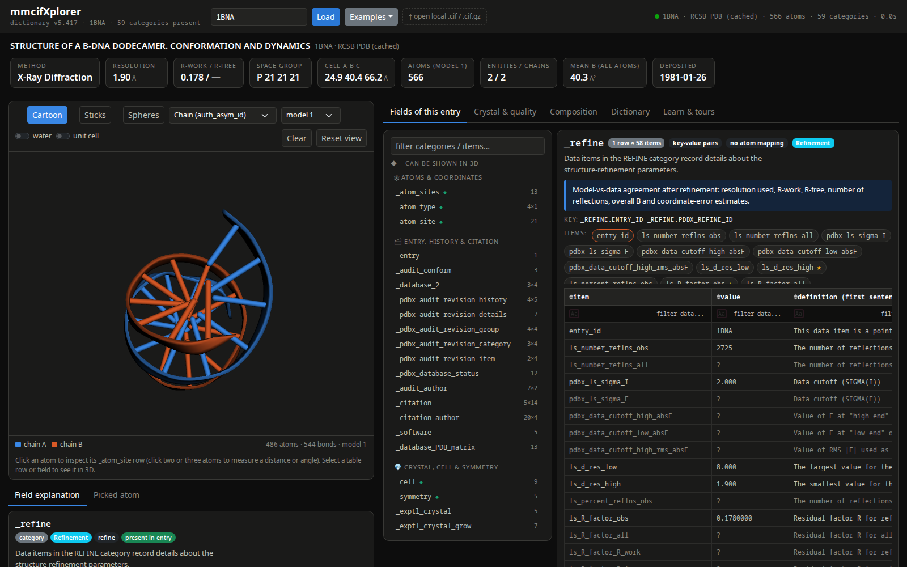
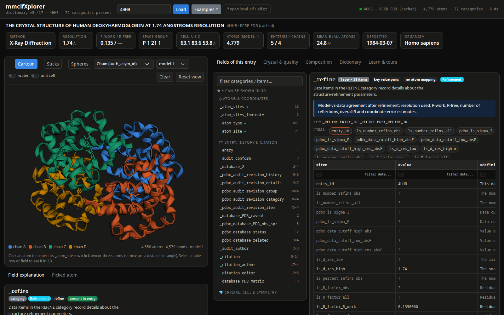

# mmcifXplorer

mmcifXplorer is an interactive dashboard for exploring a biomolecular structure file in the
[PDBx/mmCIF](https://mmcif.wwpdb.org/) format. It reads the file the way the format defines it: every category
and data item in the entry is listed and explained using its definition in the official wwPDB dictionary.

Load a structure by PDB ID, by UniProt accession (for an AlphaFold model), or from a local `.cif`/`.cif.gz`
file. The 3D structure appears on the left and the entry's mmCIF categories and items appear on the right.
Select any field to see its dictionary definition, check the entry's value against the declared type, range
and enumeration, and highlight the atoms that row describes in 3D.

| DNA: 1BNA (B-DNA dodecamer), coloured by chain | Protein: 4HHB (human deoxyhaemoglobin), coloured by chain |
|---|---|
|  |  |

```bash
conda activate biopyc          # or: conda env create -f environment.yml
python app.py                  # http://127.0.0.1:8050   (--port, --host, --debug)
python -m pytest -q tests      # 30 offline tests
```

The first start downloads the dictionaries (~1.2 MB) into `datasets/dictionary/` and builds a JSON cache.
Entries are cached in `datasets/entries/`. `1tup.cif` is bundled as an offline fallback for 1TUP.
Override the data location with `MMCIFXPLORER_DATASETS`.

## What the dashboard does

| Area | What you get |
|---|---|
| **Header** | PDB ID / `pdb_0000xxxx` / UniProt input, example entries (X-ray, NMR, cryo-EM, DNA, AlphaFold), local `.cif`/`.cif.gz` upload. Summary tiles open the definition of the item they show. |
| **3D viewer** (dash-bio `Molecule3dViewer`) | Cartoon, sticks or spheres. Colour by kind, chain, entity, file-declared secondary structure, B-factor/pLDDT, occupancy, element or residue property. Water and unit-cell toggles, NMR model selector. Click an atom to see its full `_atom_site` row, label vs auth identifiers, and every row elsewhere in the file that mentions its residue. Click 2 or 3 atoms to measure a distance or angle. |
| **Fields of this entry** | The categories present, grouped into topical sections (◆ = rows can be shown in 3D). Each category shows its dictionary description, curated notes, key, item chips, a paged/filterable/sortable table (single-row categories are transposed), the raw CIF text and the dictionary's examples. Clicking a cell explains that item **and** highlights that row's atoms. |
| **Field explanation** | Definition (with CIF sub/superscript markup rendered), type with its regular expression, units, range, enumeration (current value highlighted), aliases, parent/child links (clickable), related items, examples. The entry's value is shown with type/enum/range checks, column statistics, and a live interpretation (e.g. B → RMS displacement, wavelength → keV, R-free gap, space-group operators, a recomputed Matthews coefficient). |
| **Crystal & quality** | KPI tiles, a Matthews table (reported vs recomputed, with the content used), a 3D crystal-packing plot (ASU + symmetry copies in the unit cell), per-residue B (or pLDDT) with file secondary structure shaded, a Ramachandran plot (residues listed in `_pdbx_validate_torsion` marked), NMR ensemble spread, B histogram, and per-shell data/refinement statistics. Clicking a point highlights the residue. |
| **Composition** | Sunburst (kind → entity → label_asym instance), entity table, dash-bio `SequenceViewer` with modelled residues underlined (select a stretch to see it in 3D), and the largest categories in the entry. |
| **Dictionary** | Search all 7,216 items / 663 categories (PDBx v5.417 + ModelCIF v1.4.9) by name or definition, filter by category group or "in this entry". |
| **Learn & tours** | Six lessons drawn from the PDFs in `docs/` (file anatomy, DDL2, entity/asym/chain and label/auth numbering, crystallographic parameters, judging quality, other methods). Three guided tours step through categories, fields and 3D highlights. |

## How rows are linked to atoms

`mmcifxplorer/mapping.py` does not hard-code categories. It finds families of identifier items from the
column names (`label_asym_id`/`label_seq_id`/`label_atom_id` and their `auth_*` twins, with partner prefixes
such as `ptnr1_`, `beg_`, `range_2_`, `pdbx_` and suffixes `_1`/`_2`/`_3`). Ranges (`beg_*`/`end_*`) become
residue ranges. A few indirect categories have explicit rules: entity, struct_asym, chem_comp, the scheme
tables, assembly_gen, struct_ref_seq(_dif), atom_type and struct_site. Categories with no identifiers are
resolved through their dictionary children (e.g. `struct_sheet` → `struct_sheet_range`). For rows with two or
three atom partners, the distance or angle is recomputed from coordinates and compared with the reported value.

## Data sources

* Definitions: wwPDB `mmcif_pdbx_v50.dic` (v5.417) plus `mmcif_ma.dic` (ModelCIF v1.4.9, merged only for items
  PDBx lacks; shown with a "from ModelCIF dictionary" badge).
* Background and lessons: the PDFs in `docs/`: International Tables for Crystallography Vol. G ch. 3.6 and
  4.5 (Fitzgerald et al.), appendix A3.6.2 (Westbrook et al.), Westbrook et al. (2022) *J. Mol. Biol.* 434:167599,
  and the 1TUP wwPDB validation report.
* Structures: RCSB PDB (`files.rcsb.org`) and the AlphaFold DB API.

## Verification

The tests in `tests/test_core.py` use oracles independent of the code:

| Check | Oracle | Result |
|---|---|---|
| Atom count, per-chain atoms, residues, Zn, waters for 1TUP | wwPDB validation report | exact |
| Ramachandran "analysed" residues A/B/C = 194/192/193 | validation report | exact |
| 12 `metalc` distances | `_struct_conn.pdbx_dist_value` in the file | within 0.001 Å |
| 18 coordination angles | `_pdbx_struct_conn_angle.value` | within 0.05° |
| Helix residue counts | `_struct_conf.pdbx_PDB_helix_length` | exact |
| Cell volume, Matthews definition | textbook formulas | exact |
| Every 1TUP item is defined; every type regex compiles | dictionary | pass |

`tests/ui_smoke.py` drives a running app in headless Chromium (all tabs, a tour, NMR, cryo-EM and AlphaFold
entries) and reports Dash callback and console errors. The last run reported none.

Two differences from reported numbers are displayed rather than hidden:

* **Mean B of 1TUP**: the atom mean is 39.56 Ų. The validation report says 39.0, and no averaging convention I
  tried (residue means, without water) reproduces it.
* **Matthews coefficient of 1TUP**: recomputed V_M = 2.41 ų/Da (48.9 % solvent) from the declared ASU content
  (3 × p53 + 2 DNA strands + 3 Zn, 86.8 kDa). The file reports 2.64 / 53.4 %, which implies about 79 kDa. The
  dashboard shows both and explains the usual cause (a different mass assumption).

## Limits

* Entries with more than 40,000 non-water atoms are drawn as a backbone trace (CA/P) plus ligands. Tables and
  analyses still use every atom. A 218k-atom ribosome (5T2C) loads in ~8 s with ~0.8 GB RSS.
* The Ramachandran plot uses approximate basin outlines for orientation. Outliers are those annotated in
  `_pdbx_validate_torsion`, not a MolProbity re-analysis.
* Distances to symmetry partners (`ptnrX_symmetry` ≠ `1_555`) are flagged but not recomputed.
* Chain colours repeat after 8 chains; click an atom to identify its chain.

## User manual

A brief user manual (Obsidian-compatible Markdown) is in [`docs/mmcifXplorer_User_Manual.md`](docs/mmcifXplorer_User_Manual.md).

## License

mmcifXplorer is released under the [MIT License](LICENSE).
The wwPDB dictionaries and PDB/AlphaFold entries it downloads are not part of this repository and remain under their own terms.
